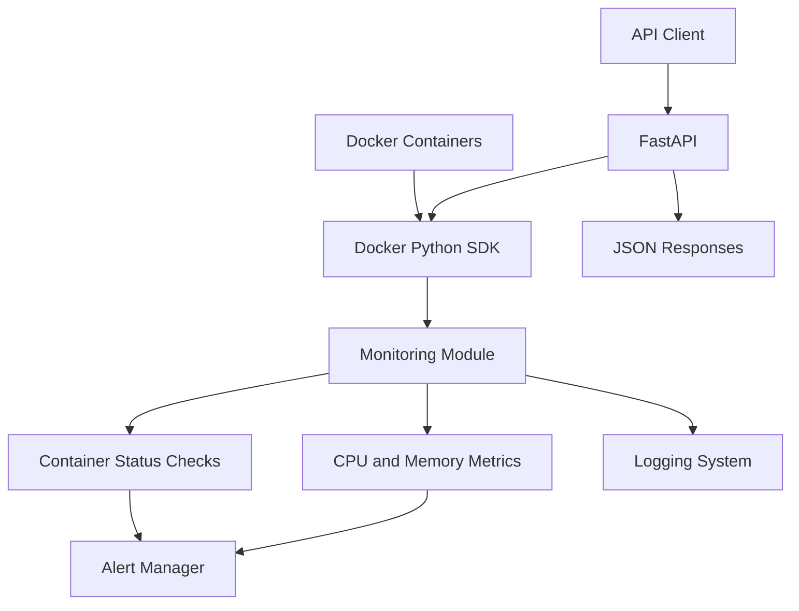

# 🐳 Docker Container Health Monitor

<p align="center">
  <strong>A Python-based monitoring tool for Docker containers</strong>
  <br />
  Monitor container status, CPU usage, memory usage, and resource alerts through a REST API and background monitoring process.
</p>

<p align="center">
  
  
  
  
</p>

---

## 📌 Overview

Docker Container Health Monitor is a Python application that monitors Docker containers and tracks their resource usage.

It provides a FastAPI REST API for retrieving container information and resource metrics. A background monitoring process checks container states and generates alerts when containers stop or CPU and memory usage exceed configured thresholds.

The project includes Docker containerization, rotating file logging, automated tests, and a Makefile for common development and Docker operations.

## ✨ Features

- 🟢 **Container Monitoring** — Monitor running and stopped containers.
- 📊 **Resource Metrics** — Track CPU and memory usage.
- 🚨 **Threshold Alerts** — Generate alerts when CPU or memory usage exceeds 80%.
- 🔄 **Recovery Alerts** — Detect container recovery and resource usage returning to normal.
- 🔁 **Duplicate Alert Prevention** — Avoid repeating the same alert during consecutive monitoring cycles.
- 🌐 **REST API** — Retrieve container details and resource metrics using FastAPI.
- 📝 **Logging** — Write monitoring logs to the console and a log file.
- 📦 **Log Rotation** — Rotate log files at 1 MB and retain up to three backup files.
- 🐳 **Dockerization** — Package the API and monitoring process in a Docker image.
- 🛠️ **Makefile** — Simplify image builds, container operations, log access, and testing.
- 🧪 **Automated Tests** — Test API endpoints and monitoring behaviour with pytest.

## 🏗️ Architecture



## 📂 Project Structure

```text
docker-health-monitor/
├── app/
│   ├── __init__.py
│   ├── main.py
│   ├── monitor.py
│   ├── metrics.py
│   ├── docker_client.py
│   └── alerts.py
├── tests/
│   ├── test_api.py
│   └── test_monitor.py
├── logs/
│   └── monitor.log
├── .github/
│   └── workflows/
│       └── ci.yml             # Add when CI workflow is created
├── .dockerignore
├── Dockerfile
├── start.sh
├── Makefile
├── requirements.txt
├── README.md
└── .gitignore
```

The `logs/` directory is used for monitoring logs. When running the Docker container, you can mount a host directory to preserve logs outside the container.

## ⚙️ Prerequisites

- Python 3.12 or compatible Python version
- Docker Engine
- Git
- GNU Make
- Basic knowledge of Python and REST APIs

## 🚀 Getting Started

### 1. Clone the repository

```bash
git clone https://github.com/Maniraj-CS/docker-health-monitor.git
cd docker-health-monitor
```

### 2. Create a virtual environment

```bash
python3 -m venv .venv
source .venv/bin/activate
```

### 3. Install dependencies

```bash
pip install -r requirements.txt
```

### 4. Start the API locally

```bash
uvicorn app.main:app --reload
```

The API will be available at:

- API root: http://127.0.0.1:8000/
- Interactive API documentation: http://127.0.0.1:8000/docs

### 5. Start the monitoring process

Open a second terminal, activate the virtual environment, and run:

```bash
python -m app.monitor
```

The monitoring process checks containers every 10 seconds.

**Note:** Both processes require access to the Docker daemon. On Linux, this normally depends on Docker socket permissions.

## 🐳 Run with Docker

The Docker image packages the API and background monitoring process together.

### 1. Build the image

Using the Makefile:

```bash
make build
```

Or directly with Docker:

```bash
docker build -t docker-health-monitor .
```

### 2. Run the container

Use the default log directory:

```bash
make run
```

The default host log directory is `logs/` inside the current project directory.

To choose a custom host directory:

```bash
make run LOG_DIR=/home/maniraj/docker-logs
```

The custom directory will be created if it does not exist.

The container exposes port `8000` and mounts the host Docker socket so the application can inspect Docker containers.

### 3. Access the API

- API root: http://127.0.0.1:8000/
- API documentation: http://127.0.0.1:8000/docs

### 4. View container logs

```bash
make logs
```

This displays the container's console output. To view the monitoring log file on the host:

```bash
tail -f logs/monitor.log
```

If you used a custom log directory, replace `logs/monitor.log` with the path to your custom directory.

### 5. Stop and remove the container

```bash
make stop
```

To force-remove the container if it is still running or has stopped unexpectedly:

```bash
make clean
```

**Important:** The `run` target uses the fixed container name `health-monitor`. If a container with that name already exists, remove it before starting another instance.

## 🛠️ Makefile Commands

| Command | Description |
|---|---|
| `make build` | Build the Docker image |
| `make run` | Start the container with the default log directory |
| `make run LOG_DIR=/path/to/logs` | Start the container with a custom host log directory |
| `make logs` | Follow the container's console logs |
| `make stop` | Stop and remove the container |
| `make clean` | Force-remove the container |
| `make test` | Run the pytest test suite |

Example:

```bash
make build
make run LOG_DIR=/home/maniraj/docker-logs
make logs
```

## 🌐 API Endpoints

| Method | Endpoint | Description |
|---|---|---|
| `GET` | `/` | Check API status |
| `GET` | `/containers` | List Docker containers |
| `GET` | `/containers/{container_name}/stats` | Retrieve resource metrics for a running container |

### Example: List containers

```bash
curl http://127.0.0.1:8000/containers
```

### Example: Retrieve container statistics

Replace `my-container` with an existing running container name.

```bash
curl http://127.0.0.1:8000/containers/my-container/stats
```

Example response:

```json
{
  "name": "my-container",
  "status": "running",
  "cpu_percent": 12.5,
  "memory_usage_mib": 64.25,
  "memory_percent": 8.4
}
```

The response values are illustrative; actual metrics depend on the container.

## 🚨 Alert Configuration

The default thresholds are defined in `app/alerts.py`:

```python
CPU_THRESHOLD = 80.0
MEMORY_THRESHOLD = 80.0
```

| Condition | Log level |
|---|---|
| Container stopped | `WARNING` |
| CPU usage exceeds threshold | `WARNING` |
| Memory usage exceeds threshold | `WARNING` |
| Container or resource recovery | `INFO` |

## 📝 Logging and Log Rotation

Monitoring logs are written to:

```text
logs/monitor.log
```

The rotating file handler uses the following configuration:

- Maximum log file size: 1 MB
- Backup files: 3
- Log levels: `INFO`, `WARNING`, and `ERROR`

The active log and its rotated backups are stored in the mounted host directory when using the Docker run configuration above. This allows logs to remain available after the container is removed.

View the log file:

```bash
tail -f logs/monitor.log
```

## 🧪 Running Tests

Run the test suite with pytest:

```bash
make test
```

Alternatively:

```bash
python -m pytest -v
```

The test suite covers API responses, Docker errors, resource threshold alerts, recovery alerts, and duplicate alert prevention.

**Latest reported local test result:** 15 passed.

## 🔐 Security Considerations

- **Docker socket access:** Mounting `/var/run/docker.sock` gives the application powerful control over the host's Docker daemon. Only grant this access to trusted applications.
- **API exposure:** Do not expose the API publicly without appropriate authentication and network security.
- **Secrets:** Never store credentials or sensitive configuration in source code.
- **Log permissions:** Ensure the host log directory has appropriate permissions.

## 🛠️ Technology Stack

<p>
  
  
  
  
  
  
</p>

## 🗺️ Project Roadmap

- [x] Docker container status monitoring
- [x] CPU and memory usage monitoring
- [x] Threshold and recovery alerts
- [x] FastAPI endpoints
- [x] Automated tests
- [x] Rotating file logging
- [x] Dockerfile and container startup script
- [x] Makefile with Docker and testing commands
- [x] `.dockerignore`
- [ ] GitHub Actions CI workflow
- [ ] Final end-to-end testing and documentation review

## 👨‍💻 Author

**Maniraj Pandit**

- GitHub: [@Maniraj-CS](https://github.com/Maniraj-CS)
- Repository: [docker-health-monitor](https://github.com/Maniraj-CS/docker-health-monitor)

---

<p align="center">
  <sub>Built to practise Python, Docker, monitoring, logging, REST APIs, and DevOps fundamentals.</sub>
</p>
