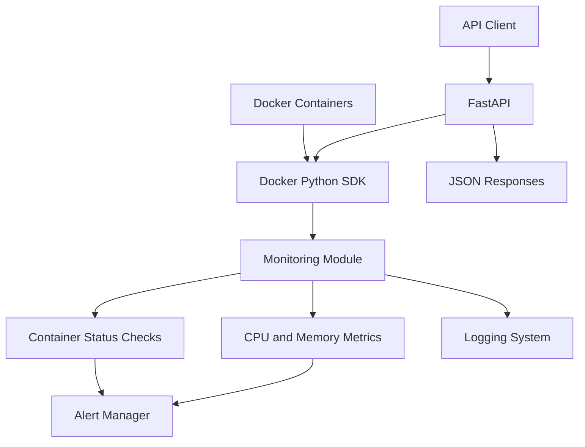

# 🐳 Docker Container Health Monitor

<p align="center">
  <strong>A Python-based monitoring tool for Docker containers</strong>
  <br/>
  Monitor container status, CPU usage, memory usage, and resource alerts.
</p>

<p align="center">
  
  
  
  
</p>

---

## 📌 Overview

Docker Container Health Monitor is a Python project that monitors Docker containers and tracks their resource usage.

It provides a FastAPI REST API to retrieve container information and resource metrics. It also generates alerts when containers stop or CPU and memory usage exceed configured thresholds.

The project is designed to practise Python, Docker, monitoring, logging, REST APIs, and automated testing.

## ✨ Features

- 🟢 **Container Monitoring** — Monitor running and stopped containers.
- 📊 **Resource Metrics** — Track CPU and memory usage.
- 🚨 **Threshold Alerts** — Generate alerts when CPU or memory usage exceeds 80%.
- 🔄 **Recovery Alerts** — Detect when a stopped container runs again or resource usage returns to normal.
- 🔁 **Duplicate Alert Prevention** — Avoid repeating the same alert during consecutive monitoring cycles.
- 🌐 **REST API** — Retrieve container details and resource metrics using FastAPI.
- 📝 **Logging** — Write monitoring logs to a file and the console.
- 📦 **Log Rotation** — Rotate the log file when it reaches 1 MB, retaining up to three backups.
- 🧪 **Automated Tests** — Test API endpoints and monitoring behaviour with pytest.

## 🏗️ Architecture



## 📂 Project Structure

```text
docker-health-monitor/
├── app/
│   ├── __init__.py
│   ├── main.py
│   ├── monitor.py
│   ├── metrics.py
│   ├── docker_client.py
│   └── alerts.py
├── tests/
│   ├── test_api.py
│   └── test_monitor.py
├── logs/
│   └── monitor.log
├── requirements.txt
├── README.md
└── .gitignore
```

## ⚙️ Prerequisites

- Python 3.12 or compatible Python version
- Docker Engine
- Git
- Basic knowledge of Python and REST APIs

## 🚀 Getting Started

### 1. Clone the repository

```bash
git clone https://github.com/Maniraj-CS/docker-health-monitor.git
cd docker-health-monitor
```

### 2. Create a virtual environment

```bash
python3 -m venv .venv
```

Activate it on Linux:

```bash
source .venv/bin/activate
```

### 3. Install dependencies

```bash
pip install -r requirements.txt
```

### 4. Start the API

```bash
uvicorn app.main:app --reload
```

The API will be available at:

- API root: `http://127.0.0.1:8000/`
- Interactive API documentation: `http://127.0.0.1:8000/docs`

### 5. Start the monitoring process

Open a second terminal, activate the virtual environment, and run:

```bash
python -m app.monitor
```

The monitor checks containers every 10 seconds.

> **Note:** Both processes require access to the Docker daemon. On Linux, this normally depends on your Docker socket permissions.

## 🌐 API Endpoints

| Method | Endpoint | Description |
|---|---|---|
| `GET` | `/` | Check API status |
| `GET` | `/containers` | List Docker containers |
| `GET` | `/containers/{container_name}/stats` | Retrieve resource metrics for a running container |

### Example: List containers

```bash
curl http://127.0.0.1:8000/containers
```

### Example: Retrieve container statistics

Replace `my-container` with an existing container name:

```bash
curl http://127.0.0.1:8000/containers/my-container/stats
```

Example response:

```json
{
  "name": "my-container",
  "status": "running",
  "cpu_percent": 12.5,
  "memory_usage_mib": 64.25,
  "memory_percent": 8.4
}
```

The values above are illustrative; actual metrics depend on the container.

## 🚨 Alert Configuration

The default thresholds are defined in `app/alerts.py`:

```python
CPU_THRESHOLD = 80.0
MEMORY_THRESHOLD = 80.0
```

| Condition | Log level |
|---|---|
| Container stopped | `WARNING` |
| CPU usage exceeds threshold | `WARNING` |
| Memory usage exceeds threshold | `WARNING` |
| Container or resource recovery | `INFO` |

## 📝 Logging

Monitoring logs are written to:

```text
logs/monitor.log
```

The log configuration uses a rotating file handler:

- Maximum log file size: 1 MB
- Backup files: 3
- Log levels: `INFO`, `WARNING`, and `ERROR`

View the logs:

```bash
tail -f logs/monitor.log
```

## 🧪 Running Tests

Run the complete test suite:

```bash
python -m pytest -v
```

The test suite covers API responses, Docker errors, resource threshold alerts, recovery alerts, and duplicate alert prevention.

**Latest local test result:** 15 passed.

## 🔐 Security Considerations

- Docker socket access can grant powerful control over the host.
- Only grant Docker access to trusted users and processes.
- Do not expose the API publicly without appropriate authentication and network security.
- Avoid storing secrets in source code or committing them to Git.

## 🛠️ Technology Stack

<p>
  
  
  
  
  
</p>

## 🗺️ Project Roadmap

- [x] Docker container status monitoring
- [x] CPU and memory usage monitoring
- [x] Threshold and recovery alerts
- [x] FastAPI endpoints
- [x] Automated tests
- [x] Rotating file logging
- [ ] Dockerfile and Docker Compose
- [ ] GitHub Actions CI workflow

## 👨‍💻 Author

**Maniraj Pandit**

- GitHub: [@Maniraj-CS](https://github.com/Maniraj-CS)

---

<p align="center">
  <sub>Built to practise Python, Docker, monitoring, and DevOps fundamentals.</sub>
</p>
